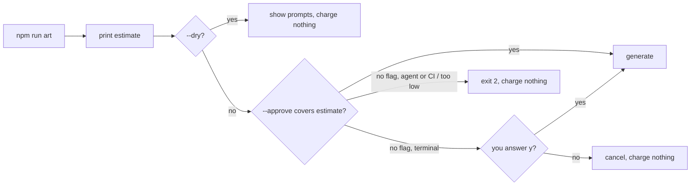

# Generated art (optional, with your own API key)

Art drawn in code (the [art-direction](../../.claude/skills/art-direction/SKILL.md), [canvas2d-assets](../../.claude/skills/canvas2d-assets/SKILL.md), [pixel-art](../../.claude/skills/pixel-art/SKILL.md) and [threejs-models](../../.claude/skills/threejs-models/SKILL.md) skills) is the default, and every game works without anything here. If you have an image-generation API key, `npm run art` can also make painted sprites, textures, tiles and key art from a prompt catalog. Claude writes the prompts, generates the images, looks at them and re-prompts, which is how Battle Drones made its first sprites and its terrain.

Generation only runs on your machine or in your agent's session. The images are saved into the game folder and bundled like any other asset, so **the shipped game never touches the network** and `npm run check` still passes.

## Setup

Set **one** of these keys:

| Variable | Provider | Notes |
|---|---|---|
| `OPENAI_API_KEY` | OpenAI image models | Native transparent backgrounds. `OPENAI_IMAGE_MODEL` overrides the model. |
| `GEMINI_API_KEY` | Google Gemini image models | `GEMINI_IMAGE_MODEL` overrides the model. Imagen was shut down on the Gemini API in August 2026. |
| `REPLICATE_API_TOKEN` | Replicate (FLUX and many others) | `REPLICATE_IMAGE_MODEL` (`owner/name`) picks the model. |

- **On your computer:** copy `.env.example` to `.env` at the repo root and fill in one key. `.env` is gitignored.
- **In a cloud agent** (Claude Code on the web, Codex): add the variable to the environment's settings. Keys already in the environment take priority over `.env`.
- When several keys are set, `ART_PROVIDER=openai|gemini|replicate` picks one. Otherwise the first in the order above is used.

Never commit a key, and never put one in a game's code.

## Cost

These are rough prices per 1024² image from October 2026 price lists. Check your provider's pricing page.

| Provider | ≈ per image |
|---|---|
| OpenAI (gpt-image-2 family) | $0.01 low · $0.05 medium · $0.21 high |
| Gemini (Flash Image) | $0.04 |
| Replicate | FLUX schnell $0.003 · dev $0.025 · 1.1 Pro $0.04 · Pro Ultra $0.06 |

A typical game needs 10–30 images plus retries, about **$0.50–$6**. Battle Drones' full set of 74 images would be about $3 at medium or $15 at high. Art drawn in code, and 3D models written in code, cost nothing beyond the agent's own usage.

`npm run art` prints an estimate before it calls anything, stops at 12 images per run unless you pass `--max`, defaults to medium quality and skips images that already exist. `--dry` shows the prompts and the estimate without calling anything.

### Nothing is charged until you agree to the cost

Every run that would spend money stops first and shows what it costs:

- **In a terminal**, it asks `This charges about $0.60 to your openai account. Generate 12 image(s)? [y/N]`. Anything but `y` cancels.
- **For an agent or CI** (no terminal to answer), it stops at the estimate and exits with code 2. It only generates when given `--approve <$>` and that amount covers the estimate. If the run turns out to cost more than was approved (more assets, higher quality), it refuses again.

**Agents:** never pass `--approve` on your own. Run `--dry`, tell the user how many images, which ones and the estimated cost, and wait for them to agree to that amount in the conversation. Then run with `--approve <that amount>`. Every later run (a re-prompt, `--force`, the next batch) is a new charge and needs its own agreement. Approving one batch doesn't approve the rest.



## The prompt catalog: `art/prompts.json`

Write one shared style contract plus reusable clauses, then one short line per asset. Every image comes from the same description, so the set reads as one game (the pattern of Battle Drones' `catalog.py`).

```json
{
  "style": "Game art for a top-down arcade space game. Strictly top-down, camera looking straight down. Bold hand-painted sci-fi style with crisp edges and a readable silhouette at 64 px. Soft light from the upper left. Weathered white and graphite hull plates with cyan (#5cc8ff) panels; cyan appears ONLY on panels, all lights are warm amber. No text, letters, logos or symbols anywhere.",
  "clauses": {
    "isolated": "One object, centred, with a generous empty margin on every side. No ground, no cast shadow, no glow, no frame.",
    "facing": "It faces straight up toward the top of the image.",
    "texture": "Seamless tileable top-down texture filling the whole image edge to edge, flat diffuse light, no large distinct objects."
  },
  "quality": "medium",
  "assets": [
    { "id": "courier", "prompt": "A small cargo courier spaceship with a cargo pod on its spine.", "use": ["isolated", "facing"], "transparent": true, "out": 256 },
    { "id": "rock-tex", "prompt": "Dark violet-grey asteroid rock surface.", "use": ["texture"], "size": "1024x1024", "out": 512 }
  ]
}
```

| Field | Meaning |
|---|---|
| `style` | The game's look in a few sentences, from `STYLE.md` (*Look*, *Scene look*, palette). It goes into every prompt. |
| `clauses` | Reusable sentences that an asset pulls in by name through `use`. |
| `quality` | `low`, `medium` or `high`. `--quality` overrides it. |
| `assets[].id` | The output file name: `assets/art/<id>.png`. |
| `assets[].size` | `1024x1024` (the default), `1536x1024` or `1024x1536`. |
| `assets[].transparent` | Needs a transparent background. OpenAI does this natively. For the other providers the prompt asks for a flat `#ff00ff` background, which is keyed out afterwards, so keep magenta out of those subjects. |
| `assets[].out` | Downscale so the longest side is at most this many px. Keep sprites ≤ 512 and sheets ≤ 2048. |

Two parts generated in one image (a hull and its turret, a sheet of 3×3 decorations) match better than separate calls. Split them apart in code, or crop them with `drawImage` source rectangles.

## Commands

```sh
npm run art -- --dry          # prompts + cost estimate, no calls
npm run art --                # generate everything that's missing (max 12 per run); asks before charging
npm run art -- --approve 0.60 # agents: generate once the user has agreed to about $0.60
npm run art -- courier --force  # redo one asset (also asks)
npm run art -- --list         # which assets exist
```

Each run:

- Saves the raw images to `art/raw/`, which is added to `.pushplayignore` automatically so it isn't shipped.
- Writes the processed PNGs (keyed, trimmed, scaled) to `assets/art/`.
- Updates a *Generated art* section in `assets/CREDITS.md`.
- Writes a contact sheet to `.github/pushplay/.work/out/<id>/__shots/generated.png`.

**Always open the contact sheet** and re-prompt anything off-style before using it.

## Using generated art well

- Generated sprites still follow the game's `STYLE.md` and the render-and-compare rounds in the [art-direction skill](../../.claude/skills/art-direction/SKILL.md). Generate a few, look at them, adjust the prompts, then do the rest.
- **Painted textures plus code-built shapes** is a strong mix. Battle Drones drapes painted terrain over a procedural 3D heightfield and uses painted rock as tiling textures on code-built cliffs.
- Generated images rarely match each other exactly, and they can't animate. For characters that need many consistent frames or facings, use the `pixel-art` skill (one model rendered from every direction) or draw them in code.
- Keep the total under the [assets.md](assets.md) limits (< 30 MB). Images are bundled, so don't load them from a URL.
- Check your provider's terms for commercial use, and keep the *Generated art* credits section accurate.
